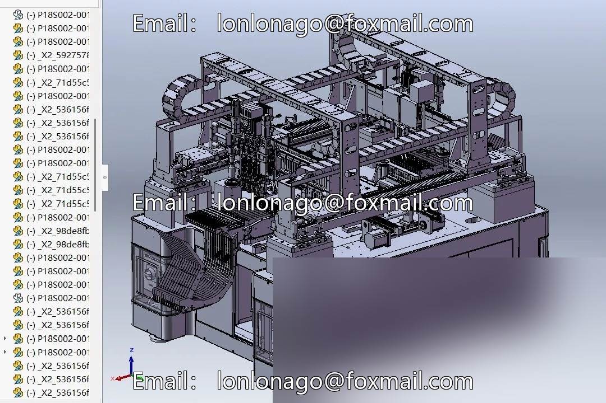
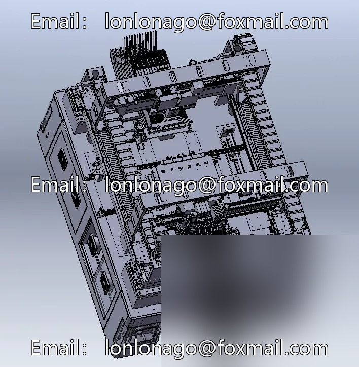

# Double-station guillotine tape-sticker machine3D

## Body

Double-station gate-clipping machine 3D double-station multi-head gate-clipping machine, designed by Korea, a classic of high-speed high-precision equipment! Very worth learning and referencing!!
SW format, no parameters.
unsellable on delivery!

A dual-station gantry stencil machine 3D is provided, depicting Korean design and high-speed high-precision equipment style; it is in SW format with no parameters and is sold without refund.

<!-- AI_ENRICHED -->

## Images

## Payment

Here is a pay link on Stripe ( https://buy.stripe.com/3cs8yP7sY87d0vu9AB ). Please contact me lonlonago@foxmail.com after funding $89, and I will send you a complete data files , thank you!

